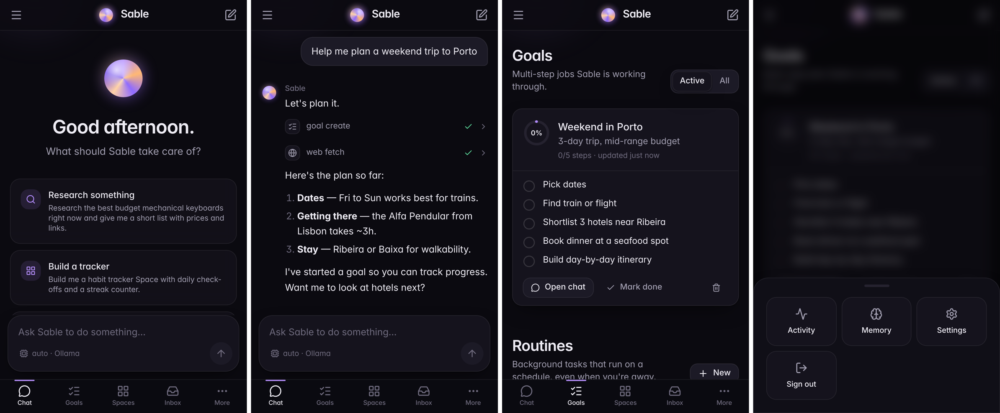

# Sable

**A self-hosted personal AI agent you reach through the web.** Sable lives on your own server: it plans multi-step jobs, uses tools, works in the background on a schedule, remembers what matters, and builds small apps ("Spaces") for you. You stay in control: anything sensitive waits for your approval, and every action is logged.

It runs on **Ollama**, **llama.cpp**, **Claude** or **OpenAI** (or any OpenAI-compatible server). You can mix them: for example, a local Ollama model as the main agent that hands coding jobs to a Claude sub-agent.

The web app installs on phones and desktops (PWA), with push notifications for approvals and finished background work.

> Inspired by the feature set of Meta's Muse personal agent (see [`docs/muse-research.md`](docs/muse-research.md)). Sable is its own product with its own design, and is self-hosted by design.




---

## Features

| | |
|---|---|
| **Chat with goals** | Describe an outcome. The agent makes a plan (a *goal* with steps), works through it with tools, and reports back. Responses stream live, with collapsible reasoning and expandable tool steps. |
| **Background work** | Runs live on the server, not in your browser tab. Close the app and the work continues. **Routines** run on a schedule (once, every N minutes, daily, weekly). |
| **Approvals (the Sentinel)** | Every tool call goes through a policy check: *Auto*, *Ask* or *Off*, per tool. Web access is approved per domain ("Always allow example.com"). Approvals show up in the chat, in the Inbox and as push notifications. |
| **Activity log** | A complete, searchable record of every action each agent took, approved, or was blocked from taking. |
| **Sub-agents** | Configurable specialists, each with its own provider, model, effort and toolset. The defaults are a **Coder** (Claude, with files and scripts) and a **Researcher** (Ollama, with web search and fetch). |
| **Memory** | The agent saves lasting facts about you. You can see, edit and delete every one, and tell it to forget. |
| **Spaces** | Ask for a tracker, dashboard, planner or board, and the agent builds a sandboxed mini-app that saves its own data and can ask the agent questions. |
| **Connectors** | Plug in any **MCP server** (email, calendar, notes, GitHub, Home Assistant…). Connector actions ask for approval until you allow them. |
| **Tools** | Web search (DuckDuckGo or your SearXNG), page reading, HTTP/API requests, a sandboxed workspace folder, Python/Node/Bash scripts, notifications, schedules, goals, memory, spaces, delegation. |
| **Installable & animated** | PWA for iOS, Android and desktop. Smooth motion throughout, with light and dark themes. |

## Lessons designed in

Muse's launch surfaced real problems. Sable avoids them on purpose:

- **Agents say they're agents.** Web requests use the user agent `SableAgent/0.1 (+self-hosted personal AI agent; automated)`. The system prompt forbids claiming to be human.
- **No public share links.** Nothing is shareable by URL, and everything sits behind your password.
- **Explicit scopes.** Connectors and sensitive tools ask first. File and script tools are confined to a workspace folder. Scripts run with a stripped environment, so your API keys never reach them.
- **Approval fatigue is tunable.** "Always allow" is scoped (one tool, or one domain), so you trust what you choose and nothing more.
- **Prompt-injection hygiene.** Web, connector and file content is wrapped as `<untrusted>` data that the agent is told never to obey.
- **Secrets stay server-side.** API keys are masked in the UI and never sent to the browser or to the model.
- **Spaces are sandboxed.** They run in an iframe with no same-origin access, and a CSP blocks all network calls except two script CDNs.

---

## Quick start

Requires **Node.js 22.5+** (uses the built-in SQLite).

```bash
# 1. A local model (any tool-capable model works: qwen3, llama3.1, mistral-nemo, gpt-oss…)
ollama pull qwen3:8b

# 2. Sable
npm install
npm run build
npm start            # → http://localhost:8787
```

Open the page and choose a password. Then go to **Settings → Models** to pick your main model. If you leave it on auto, Sable uses the first model Ollama reports.

### Docker

```bash
docker compose up -d                                      # Sable + Ollama
docker compose exec ollama ollama pull qwen3:8b
```

Data (database, workspace, keys) lives in the `sable-data` volume.

### Development

```bash
npm run dev          # API on :8787 (auto-reload) + Vite on :5173 with HTTP proxying
```

## Reaching it from your phone (HTTPS)

Installing as an app and push notifications both require **HTTPS** (except on `localhost`). The easiest options:

- **Tailscale** (private, nothing exposed publicly): `tailscale serve --bg 8787`, then open `https://<machine>.<tailnet>.ts.net`.
- **Caddy** on a domain you own: `sable.example.com { reverse_proxy localhost:8787 }`.

Then open Sable on your phone. On **iOS**, use Share → *Add to Home Screen* (push notifications on iOS only work from the Home Screen app). On **Android/desktop**, use *Install app* in the browser menu. Turn on notifications in **Settings → Notifications**.

## Configuration

Most things are set in the UI. Environment variables:

| Variable | Default | |
|---|---|---|
| `PORT` / `HOST` | `8787` / `0.0.0.0` | Where the server listens |
| `SABLE_DATA_DIR` | `./data` | Database, workspace folder, generated keys |
| `OLLAMA_HOST` | `http://127.0.0.1:11434` | Initial Ollama URL |
| `LLAMACPP_URL` | `http://127.0.0.1:8080/v1` | Initial llama.cpp server URL (run `llama-server --jinja` for tool calling) |
| `SABLE_MODEL` | (auto) | Initial main model |
| `ANTHROPIC_API_KEY` / `OPENAI_API_KEY` | | Initial keys (can also be set in the UI) |
| `SEARXNG_URL` | | Use your SearXNG for web search |
| `TZ` | system | Time zone for routines |
| `SABLE_TRUST_PROXY` | private ranges | Express `trust proxy` setting, for HTTPS detection behind a proxy |
| `SABLE_VAPID_SUBJECT` | `mailto:sable-agent@example.com` | Contact for web push (VAPID) |

### Example: local main agent + Claude for scripting

1. **Settings → Models**: set the main agent to *Ollama · qwen3:8b*, and paste your Anthropic key into the *Claude* provider.
2. **Settings → Sub-agents**: the **Coder** already uses *Claude · claude-opus-5-5* with file and script tools. Add more agents if you like, for example a second Ollama model for summaries.
3. Ask: *"Write a script that renames my photos by date."* The main agent delegates to the Coder. You see the Coder's steps nested inside the delegation, and scripts still wait for your OK.

### Example: a connector

**Settings → Connectors → Add connector**, local command:

```
command:  npx
args:     -y
          @modelcontextprotocol/server-filesystem
          /home/me/Notes
```

Save, then its tools appear under **Permissions**, set to *Ask* by default.

## Architecture

```
server/  Node + Express + node:sqlite
  src/agent/runner.ts     agent loop: streaming, tool execution, sub-agents, background runs
  src/agent/sentinel.ts   policy decisions + approvals
  src/agent/tools/        built-in tools and MCP connectors
  src/llm/                Ollama, OpenAI-compatible (OpenAI, llama.cpp, LM Studio…), Anthropic SDK
  src/scheduler.ts        routines
  src/push.ts             web push (VAPID keys generated on first run)
web/     React 19 + Vite + Tailwind 4 + Motion, PWA with a custom service worker
```

The browser receives live updates over Server-Sent Events (`/api/events`). Runs are owned by the server, so any device can watch or approve them.

## Security notes

- Sable is single-user. Protect it with a strong password, and prefer a private network (Tailscale/VPN) over exposing it to the internet.
- `run_script` executes code **on your server** as the Sable user, confined to the workspace directory, with a minimal environment and a timeout. It is not a container sandbox. Run Sable in Docker, or as an unprivileged user, if that matters to you, or set *Run script* to *Off*.
- Connectors run with whatever access you give them.
