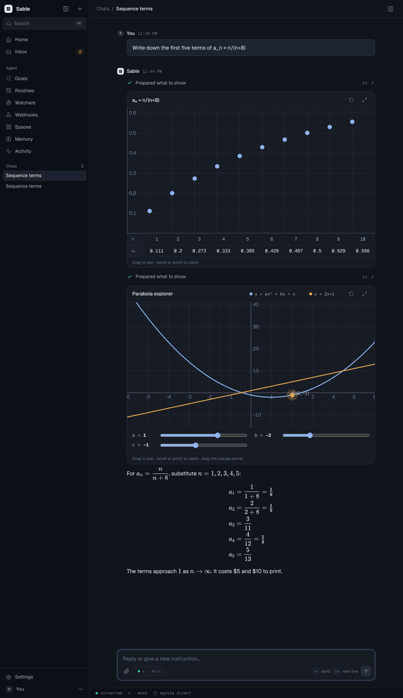

# Math and graphs

## Math in replies

Sable typesets math with [KaTeX](https://katex.org). Models write math in different ways, and all of them work:

| The model writes | Shows as |
|---|---|
| `$x^2$`, `\(x^2\)` | inline math |
| `$$\frac{n}{n+8}$$`, `\[ … \]` | a centered block |

Qwen and most open models use `\( … \)` and `\[ … \]`. Sable converts those before rendering. Code blocks are never touched.

A single `$…$` only counts as math when it looks like math (it has `^`, `_`, `\`, `=`, a lone variable, a plain number like `$1$`, and so on). So "it costs $5 and $10" stays text. If a model writes something that should be math but shows up as text, ask it to use `\( … \)`.

## Interactive graphs

When a picture helps, the agent calls **`show_graph`** (group *Math*, runs without asking). It fills in a ready-made graph and the chat draws it:

- **Functions** of `x`, for example `x^2 - 3x + 2` or `a*sin(b*x)`.
- **Parametric curves** in `t`, with a `t` range.
- **Sequences** in `n`. They're drawn as points with a table of values (up to 200 terms).
- **Points.** They can be fixed or **movable**. A movable point can be locked onto a function (`on: 0`), so dragging it traces the curve and its coordinates update live.
- **Sliders** (`params`) for any letter used in the formulas. Moving one redraws everything, and points locked to a curve follow it.

What you can do with a graph:

- Drag to pan; scroll or pinch to zoom.
- Drag the orange points. You can also click one and use the arrow keys.
- Click a legend entry to hide or show that line.
- **Reset view**, or **Expand** to full screen.

The axes fit themselves to what's drawn unless the agent sets `x_range` and `y_range`.

### Formula syntax

`+ - * / ^`, parentheses, implicit multiplication (`2x`, `3(x+1)`, `ax` means `a*x` when `a` is a slider) and these functions: `sin cos tan asin acos atan atan2 sinh cosh tanh sec csc cot sqrt cbrt abs exp ln log log2 floor ceil round sign min max mod`. Constants: `pi`, `e`, `tau`. `y = …` and `f(x) = …` prefixes are fine.

Formulas are parsed by Sable's own small parser, not run as code, so a graph can't execute anything. The server checks every formula before the card is shown. If one is wrong, the model gets the error and can fix it.

### Asking for one

Ask the way you normally would: "graph sin x and its derivative", "show the first 20 terms of 1/n²", "let me play with the vertex form a(x−h)²+k". With a small local model, "use show_graph" helps.
